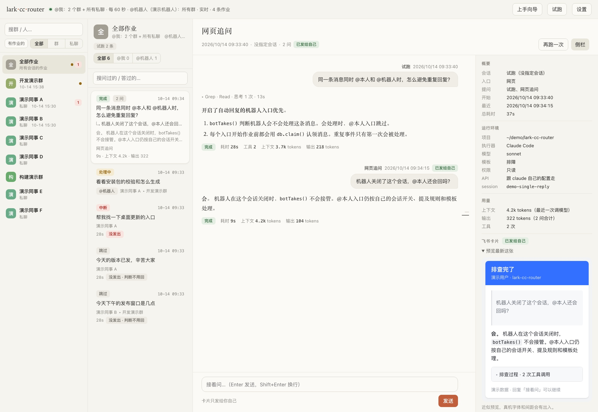

# 使用示例

能查到什么，取决于本机接了哪些工具、有哪些权限。

怎么问、怎么追问，见 [README](../README.md#在飞书里怎么用)；追问怎么接上同一个 session，见 [session.md](session.md)。

## web UI 试跑

用只读模板试跑一句：「同一条飞书消息同时 @本人和 @机器人时，项目如何避免重复回复？」CC 查了 `botTakes()` 和 `db.claim()`。再在对话底下的输入框里接着问，两次用的是同一个 session，中栏聚成一行。

## 先判定

用「只看判定」跑出来的实际结果：

| 输入 | 判定 | 真实消息会怎么处理 |
|---|---|---|
| 帮我查一下这个订单为什么一直没有修改成功，测试单号 TEST-1001 | **要回** | 交给 CC 排查 |
| 大家辛苦了，今天的发布已经结束，谢谢！ | **不用回** | 不发卡片，记下跳过的理由 |
| 这个需求你预计什么时候能做完？ | **转给我** | 私聊提醒你，群里不代答 |
| 不用查了，停止处理 | **叫停** | 对上追问锚点就只掐那个 session，对不上就掐这个会话里所有在跑的 |

判定结果由模型和模板的判定提示词决定，不是固定规则。「只看判定」只出结论，不会真的去叫停或发提醒。规则见 [judge.md](judge.md)。
